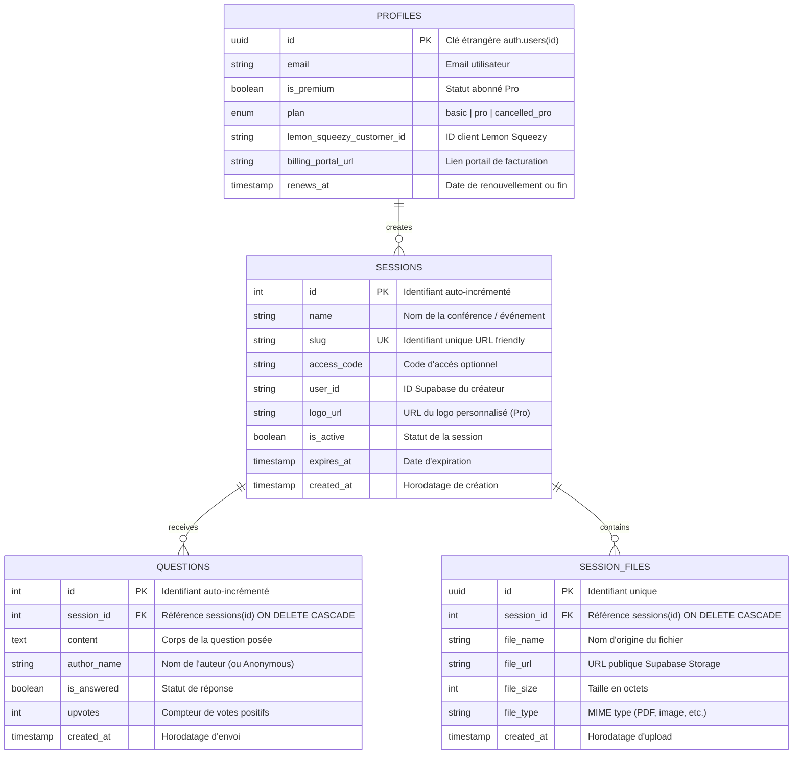

# QALive (LiveQA) - Documentation Complète d'Architecture & Contexte Global

> **Document destiné aux développeurs et agents d'IA**  
> Ce document fournit une vision exhaustive à 360° du projet QALive : vision produit, stack technique, architecture logicielle, flux de données, modèle de base de données, monétisation, pièges connus et dette technique.

---

## 1. Vue d'Ensemble & Vision Produit

**QALive** (nom de code / package : `liveqa`) est une application web SaaS interactive de questions-réponses en direct conçue pour les conférences, webinaires, cours magistraux, réunions d'entreprise et événements publics.

### Le Problème Résolu
Lors d'une présentation ou conférence, poser des questions à l'oral est souvent intimidant, désorganisé ou chronophage. QALive permet à l'organisateur de projeter un QR code à l'écran. Les participants le scannent depuis leur smartphone, accèdent instantanément à une page web dédiée sans inscription, et soumettent leurs questions ou consultent les documents partagés en direct.

### Deux Rôles Principaux
1. **L'Organisateur (Host) :**
   - Se connecte (Google OAuth).
   - Crée des sessions d'événements (avec options Pro : durée personnalisée, logo de marque).
   - Projette la vue QR Code plein écran pour l'audience.
   - Suit en temps réel les questions entrantes sur son tableau de bord / vue modérateur.
   - Projette une question agrandie à l'écran en un clic (navigation clavier avec flèches gauche/droite).
   - Partage des documents (slides PDF, images, etc.) téléchargeables en direct par les participants.
2. **Le Participant (Audience) :**
   - Accès public instantané via `https://app.qalive.ink/ask/:slug` ou via le QR code.
   - Aucune authentification requise.
   - Peut poser une question (anonymement ou avec son nom).
   - Accède en temps réel aux documents partagés par le conférencier.

---

## 2. Stack Technique & Écosystème

| Domaine | Technologies | Notes & Rôle |
| :--- | :--- | :--- |
| **Frontend Framework** | **Vue 3** (v3.5+) | Utilisation exclusive de l'API Composition avec `<script setup>`. |
| **State Management** | **Pinia** (v3.0+) | Stores modulaires : `auth`, `session`, `question`, `file`. |
| **Routing** | **Vue Router** (v4.5+) | Navigation SPA avec guards d'authentification (`meta: { requiresAuth: true }`). |
| **Styling & UI** | **Tailwind CSS** (v3.4+) | Design épuré, typographie personnalisée (famille Mabry Pro, Nunito, Jakarta). |
| **Icons & Assets** | **Google Material Symbols Outlined** + SVG natifs | Icônes d'action et illustrations vectorielles dédiées. |
| **QR Code Engine** | `qrcode.vue` / `@chenfengyuan/vue-qrcode` | Génération de QR codes vectoriels haute résolution (niveau d'erreur 'H'). |
| **Backend / BaaS** | **Supabase** (`@supabase/supabase-js` v2) | Authentification OAuth, base de données PostgreSQL, Realtime WebSocket, Storage. |
| **ORM / Migration** | **Prisma** (v6.16+) | Client généré dans `src/generated/prisma`, migrations et gestion du schéma relationnel. |
| **Edge Functions** | **Supabase Edge Functions** (Deno) | Webhook Lemon Squeezy pour la synchronisation des abonnements. |
| **Paiement / Facturation** | **Lemon Squeezy** | Solution Merchant of Record, overlay checkout (`lemon.js`), webhook HMAC. |
| **Build & Tooling** | **Vite** (v7.1+) + ESLint v9 + Prettier | Bundler ultra-rapide avec support d'alias `@/` vers `./src`. |
| **Hébergement & Déploiement** | **Vercel** (`vercel.json`) | SPA Rewrites vers `/index.html`, domaine de production : `app.qalive.ink`. |
| **Analytics** | **Plausible Analytics** | Tracking éthique sans cookies configuré dans `index.html`. |

---

## 3. Structure Détaillée du Projet

```bash
qalive-app/
├── index.html                  # Point d'entrée HTML, meta SEO, OpenGraph, scripts Plausible & fonts
├── package.json                # Dépendances, scripts npm (dev, build, prisma, lint)
├── tailwind.config.js          # Configuration Tailwind (couleurs primary, secondary, fonts Mabry)
├── vite.config.js              # Config Vite (alias @, plugins Vue et DevTools)
├── vercel.json                 # Règles de redirection SPA pour le déploiement Vercel
├── prisma/
│   ├── schema.prisma           # Définition des modèles PostgreSQL (Session, Question, Profile, Plan)
│   └── migrations/             # Historique des migrations SQL versionnées
├── supabase/
│   ├── config.toml             # Configuration du projet et des fonctions Supabase
│   └── functions/
│       └── lemon-squeezy-webhook/  # Edge function Deno traitant les événements Lemon Squeezy
│           ├── index.ts        # Vérification signature HMAC, mise à jour du profil utilisateur
│           └── deno.json       # Config Deno de la fonction
├── public/                     # Assets statiques servis directement (logos, fonts, illustrations SVG)
│   ├── fonts/                  # Polices Mabry Pro, Nunito, Plus Jakarta Sans
│   ├── illustrations/          # Illustrations d'états vides et métriques
│   └── logos/                  # Variantes de logo par défaut et logos tiers
└── src/
    ├── main.js                 # Initialisation de Vue, Pinia, Vue Router et import des styles
    ├── App.vue                 # Composant racine contenant simplement <RouterView />
    ├── assets/                 # CSS global (@font-face, tailwind directives)
    ├── datas/                  # Données statiques et helpers d'affichage (dashboard, mock data)
    │   ├── dashboardDatas.js   # Définition des 3 cartes métriques du dashboard
    │   └── sessionDatas.js     # Données de test historiques
    ├── utils/
    │   └── dateHelper.js       # Utilitaires de formatage de dates et heures avec timezone locale
    ├── lib/
    │   ├── supabase.js         # Instance singleton Supabase Client (VITE_SUPABASE_URL, ANON_KEY)
    │   └── lemonSqueezy.js     # (Fichier réservé pour les futures intégrations SDK)
    ├── services/
    │   └── sessionService.js   # Couche service abstraction Supabase (pagination, stats dashboard)
    ├── stores/                 # Stores Pinia (logique métier & état réactif)
    │   ├── authStore.js        # Auth Google, session utilisateur, écouteur onAuthStateChange
    │   ├── sessionStore.js     # Gestion des sessions, quotas freemium, uploads logos, pagination
    │   ├── questionStore.js    # Récupération, ajout, souscription Realtime Supabase aux questions
    │   └── fileStore.js        # Stockage de fichiers de session, upload Storage & souscription Realtime
    ├── layouts/
    │   └── AppLayout.vue       # Layout standard centré avec conteneur max-w-5xl
    ├── components/
    │   ├── basis/
    │   │   ├── NavBar.vue              # Barre de navigation flottante
    │   │   ├── dashboardCard.vue       # Carte métrique individuelle du tableau de bord
    │   │   ├── questionCard.vue        # Carte question affichée dans la grille organisateur
    │   │   ├── CreateSessionModal.vue  # Modale de création d'événement (options Free / Pro)
    │   │   ├── UpgradePlanModal.vue    # Modale incitant au passage au plan Pro ($12.99/mois)
    │   │   ├── BadgeComponent.vue      # Badge d'information ("Coming soon")
    │   │   ├── ModalsTemplate.vue      # Template générique réutilisable pour modales
    │   │   └── SessionCard.vue         # Carte de session (vue alternative)
    │   └── files/
    │       ├── FileUpload.vue          # Formulaire d'upload de document lié à la session
    │       └── FileList.vue            # Liste des fichiers avec icônes selon extension et bouton download
    └── views/
        ├── LoginView.vue               # Connexion organisateur (Google OAuth)
        ├── HomeView.vue                # Tableau de bord principal (stats, liste des sessions, filtres)
        ├── QuestionsView.vue           # Vue organisateur de la session (grille questions + projection modale + fichiers)
        ├── AskQuestionView.vue         # Vue publique participant (formulaire d'envoi de question + docs)
        ├── SessionQRCodeView.vue       # Vue plein écran du QR Code à projeter sur écran géant
        ├── CreateSessionView.vue       # Page alternative de génération de QR Code post-création
        └── UserProfileView.vue         # Gestion du compte, affichage du plan et lien portail client
```

---

## 4. Architecture de Données & Schéma de Base de Données

Le backend s'appuie sur une base de données relationnelle **PostgreSQL** hébergée sur Supabase.

### Diagramme Entités / Relations (ERD)



### Détail des Tables et Rôles

1. **`profiles`** :
   - Lié 1-à-1 avec l'utilisateur authentifié Supabase (`auth.users.id`).
   - Gère le statut de monétisation (`is_premium`, `plan`, `lemon_squeezy_customer_id`, `billing_portal_url`).
2. **`sessions`** :
   - Représente un événement ou une présentation.
   - Possède un `slug` unique utilisé dans les routes publiques (`/ask/:slug`) et privées (`/session/:slug`).
   - Contient une date `expires_at` déterminant la validité de l'événement.
3. **`questions`** :
   - Questions soumises par l'audience pendant la session.
   - Relié à `sessions` avec contrainte `ON DELETE CASCADE`.
4. **`session_files`** :
   - Fichiers attachés à une session (supports de présentation, ressources, PDF).
   - Les fichiers réels sont stockés dans le bucket Supabase Storage `session-files`.

### Buckets Supabase Storage
- **`sessions-logos`** : Stocke les logos de marque personnalisés uploadés par les membres Pro lors de la création d'une session.
- **`session-files`** : Stocke les documents partagés aux participants pendant l'événement (chemin : `${sessionId}/${timestamp}_${fileName}`).

---

## 5. Fonctionnalités & Logique Métier

### Modèle Freemium vs Pro

L'application applique une segmentation stricte entre les utilisateurs gratuits et les abonnés Pro :

| Fonctionnalité | Plan Gratuit (Basic) | Plan Pro ($12.99 / mois) |
| :--- | :--- | :--- |
| **Nombre de sessions** | **Maximum 3 sessions au total** | **Sessions illimitées** |
| **Questions par session** | **Maximum 70 questions** | **Questions illimitées** |
| **Durée d'une session** | **Fixée obligatoirement à 2 heures** | **Personnalisable de 1h à 72h** |
| **Branding / Logo** | Variante aléatoire de logo prédéfini | **Upload de logo de marque personnalisé** |
| **Suppression de session** | Bloquée (icône verrouillée avec tooltip Pro) | **Autorisée** |
| **Gestion d'abonnement** | Bouton de mise à niveau vers Pro | **Accès au portail client Lemon Squeezy** |

### Flux Temps Réel (Supabase Realtime)

QALive utilise deux canaux de WebSockets Supabase pour garantir l'interactivité en direct sans rechargement :

1. **Canal des questions (`questions:session_${sessionId}`)** :
   - Écoute les événements `INSERT` sur la table `questions` avec le filtre `session_id=eq.${sessionId}`.
   - Dès qu'un participant soumet une question, celle-ci s'ajoute immédiatement en tête de liste (`unshift`) sur l'écran de l'organisateur.
2. **Canal des fichiers (`files:session_${sessionId}`)** :
   - Écoute les événements `INSERT` sur la table `session_files`.
   - Permet aux participants de voir apparaître les nouveaux documents partagés en temps réel pendant la présentation.

### Projection Plein Écran & Mode Scène
- Sur `QuestionsView.vue`, l'organisateur peut cliquer sur n'importe quelle carte de question pour ouvrir une modale de projection grand format (parfait pour vidéoprojecteur / écran de scène).
- Prise en charge des **touches du clavier** (`Flèche Gauche` / `Flèche Droite`) pour passer à la question précédente ou suivante sans toucher la souris.

---

## 6. Monétisation & Intégration Lemon Squeezy

### Tunnel d'Achat
1. L'utilisateur clique sur **"Upgrade to Pro"** ou dépasse la limite de 3 sessions.
2. La modale `UpgradePlanModal.vue` s'affiche.
3. Le lien de checkout Lemon Squeezy est dynamiquement enrichi avec les informations de l'utilisateur :
   ```javascript
   finalUrl += `checkout[custom][user_id]=${user.value.id}`
   finalUrl += `&checkout[email]=${user.value.email}`
   ```
4. Le client effectue son paiement sur la page sécurisée de Lemon Squeezy.

### Edge Function Webhook (`supabase/functions/lemon-squeezy-webhook/index.ts`)
Lemon Squeezy notifie l'application via un webhook sécurisé :
- **Sécurité :** Vérification de la signature HMAC SHA-256 via l'en-tête `x-signature` et la clé secrète `LEMON_SQUEEZY_WEBHOOK_SECRET`.
- **Événements gérés :**
  - `subscription_created` & `subscription_payment_success` :
    - Récupère le `user_id` depuis `custom_data` (avec un mécanisme de fallback par recherche de l'email dans `profiles`).
    - Met à jour `profiles` : `is_premium = true`, `plan = 'pro'`, `lemon_squeezy_customer_id`, `billing_portal_url`.
  - `subscription_cancelled` :
    - L'utilisateur a demandé l'arrêt du renouvellement mais conserve ses accès jusqu'à la date d'échéance `ends_at`.
    - Met à jour `profiles` : `plan = 'cancelled_pro'`, `renews_at = endsAt`, conserve `is_premium = true`.
  - `subscription_expired` :
    - L'abonnement est arrivé à son terme définitif.
    - Met à jour `profiles` : `is_premium = false`, `plan = 'basic'`, reset des URLs de portail.

---

## 7. Variables d'Environnement

Le projet requiert les variables d'environnement suivantes :

### Frontend (`.env` ou environnement Vercel)
```env
# URL de l'instance Supabase
VITE_SUPABASE_URL=https://<votre-id-supabase>.supabase.co

# Clé publique anonyme Supabase (pour requêtes frontend protégées par RLS)
VITE_SUPABASE_ANON_KEY=eyJhbGciOi...

# URL de connexion PostgreSQL directe pour Prisma
DATABASE_URL=postgresql://postgres:<mot-de-passe>@db.<votre-id-supabase>.supabase.co:5432/postgres
```

### Backend / Supabase Edge Functions (Secrets Supabase)
```env
# Clé secrète configurée dans le webhook Lemon Squeezy
LEMON_SQUEEZY_WEBHOOK_SECRET=votre_secret_webhook

# Clé de service Supabase (accès complet pour mise à jour des profils)
SUPABASE_SERVICE_ROLE_KEY=eyJhbGciOi...

# URL du projet Supabase pour l'Edge Function
SUPABASE_URL=https://<votre-id-supabase>.supabase.co
```

---

## 8. Commandes & Scripts Utiles

```bash
# Installation des dépendances
npm install

# Démarrer le serveur de développement Vite
npm run dev

# Compiler pour la production
npm run build:prod

# Lancer la prévisualisation du build de production
npm run preview

# Linter et corriger le code avec ESLint
npm run lint

# Formater le code avec Prettier
npm run format

# Synchroniser le client Prisma avec la base de données
npm run prisma:generate

# Pousser les modifications du schéma Prisma en développement
npm run prisma:push:dev

# Ouvrir l'interface graphique Prisma Studio pour explorer les tables
npm run prisma:studio:dev
```

---

## 9. Micro-Analytics Intégré (Pulse Analytics) & Sécurité Serveur

### Pulse Analytics (`/analytics` & `src/lib/analytics.js`)
Un outil d'analytics minimaliste sans cookies (inspiré de Plausible) est directement intégré dans l'application :
- **Empreinte anonyme quotidienne** (`getDailyVisitorHash`) : aucun cookie stocké, aucune IP conservée.
- **Suivi automatique des pages** via `router.afterEach` (`analytics_page_views`).
- **Suivi du funnel produit** (`analytics_events`) : `login_initiated`, `session_created`, `question_submitted`, `question_limit_reached`, `document_uploaded`, `upgrade_modal_opened`, `checkout_clicked`.
- **Dashboard `/analytics` (`src/views/AnalyticsView.vue`)** : affiche les visiteurs uniques, pages vues, **North Star Metric** (sessions avec $\ge 5$ questions), taux d'activation, graphique quotidien, top pages, top sources, funnel de conversion et répartition Mobile/Desktop.
- **Mode hybride** : fonctionne immédiatement en cache local (`localStorage`) et bascule automatiquement sur Supabase dès que le script SQL de migration est exécuté.

### Migration SQL de Sécurité (`supabase/migrations/20261102_fix_critical_bugs_and_analytics.sql`)
Ce script SQL ajoute les garde-fous côté serveur PostgreSQL :
1. Alignement de l'enum `"Plan"` avec `'pro'` et `'cancelled_pro'` (ainsi qu'un mécanisme de fallback automatique dans le webhook Lemon Squeezy).
2. Fonction RPC `get_public_session_status(p_slug)` (`SECURITY DEFINER`) permettant à `/ask/:slug` de vérifier l'expiration et la limite de 70 questions sans exposer la table `profiles`.
3. Triggers PostgreSQL `trg_enforce_session_creation_limits` (max 3 sessions et durée 2h en gratuit) et `trg_enforce_question_submission_limits` (max 70 questions et blocage si session expirée).
4. Création des tables `analytics_page_views` et `analytics_events` avec politiques RLS.

---

## 10. Branches Git & État des Lieux du Repository

- **`develop`** : Branche de travail active actuelle (code stable en cours de perfectionnement).
- **`main`** : Branche de production déployée sur Vercel.
- **`future_version_exploration`** : Branche d'exploration contenant des travaux avancés sur une nouvelle ergonomie UI/UX (refonte inspirée d'une maquette Figma avec une barre latérale pour les questions de participants : `ParticipantQuestionItem.vue` / `SessionSideBar`).
